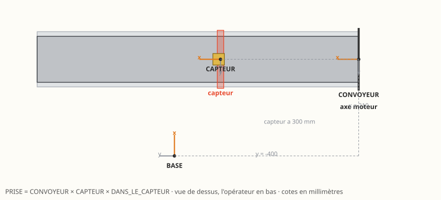

# Prendre une pièce sur le convoyeur — activité de programmation

IUT, université de Bordeaux · Dobot Magician, ventouse et convoyeur
À lire avec le [manuel](README.md) et la [procédure de mise en route](PROCEDURE_CONVOYEUR.md)

---

## La cellule



Le tapis amène une pièce, un capteur la voit arriver, le tapis s'arrête,
le robot la prend et la dépose à côté.

Le geste est simple. Ce que l'activité demande, c'est de **savoir où est
la pièce sans jamais y amener le bras à la main** — en composant trois
matrices :

```python
PRISE = CONVOYEUR @ CAPTEUR @ DANS_LE_CAPTEUR
```

| Matrice | Ce qu'elle situe | Mesurée par rapport à |
|---|---|---|
| `CONVOYEUR` | le tapis | la **base du robot** |
| `CAPTEUR` | le capteur | le **tapis** |
| `DANS_LE_CAPTEUR` | la ventouse sur la pièce | le **capteur** |

> **Le critère de réussite.** Déplacez le capteur de trois centimètres
> le long de la bande : **un seul nombre** doit changer dans votre
> programme. Si vous avez dû en toucher deux, votre chaîne n'en est pas
> une.

---

## 1. Mettre le robot en route

```bash
cd cellule
python dobot.py mise-en-route
```

Attendez **`mise en route terminee : defauts effaces`**. Dégagez la
zone, bras haut, base au milieu de sa course, main près de
l'interrupteur.

---

## 2. Le convoyeur par rapport à la base du robot

### 2.1 Choisir la référence

**L'origine du repère du tapis est l'AXE DU MOTEUR.** Pas « le début de
la bande » : la bande tourne, elle n'a pas de début.

L'axe moteur, lui, est un objet **matériel** — on le montre du doigt, on
y pose un réglet, et on y revient demain avec le même résultat.

> **Question 1.** Citez deux autres points de la cellule qui feraient
> une mauvaise origine, et dites pourquoi. Qu'ont-ils en commun ?

### 2.2 Mesurer

Trois cotes, prises **par rapport au centre de la base du robot** :

| | Ce qu'on mesure | Sur cette cellule |
|---|---|---|
| `x` | de la base au **centre** du convoyeur | 210 mm |
| `y` | de la base à l'**axe moteur** | −400 mm |
| `z` | hauteur de la bande | 60 mm |

Le signe de `y` se lit sur le robot : l'opérateur qui lui fait face le
voit déplier son bras **en s'éloignant** de lui — le `+x` pointe donc
vers le convoyeur, et le `+y` tombe à **gauche** de l'opérateur. L'axe
moteur étant à sa droite, `y` est négatif.

### 2.3 Écrire la matrice

```python
CONVOYEUR = np.array([[ 0, -1, 0,  210],
                      [ 1,  0, 0, -400],
                      [ 0,  0, 1,   60],
                      [ 0,  0, 0,    1]], dtype=float)
```

Lisez-la **colonne par colonne** :

| Colonne | Ce qu'elle dit |
|---|---|
| 0 : `(0, 1, 0)` | l'axe **x** du tapis — **le sens de marche** — pointe vers le `+y` du robot |
| 1 : `(−1, 0, 0)` | son **y**, en travers de la bande |
| 2 : `(0, 0, 1)` | son **z**, vers le **haut** : c'est une table, pas un outil |
| 3 : `(210, −400, 60)` | où se trouve l'axe moteur |

> **Le sens de marche ne se choisit pas, il se déduit.** On pose `y` sur
> l'axe moteur, `z` vers le haut, et `x = y ∧ z` pour que le repère
> reste direct. Retourner le tapis, c'est prendre l'axe moteur dans
> l'autre sens — et rien d'autre à reprendre.

> **Question 2.** Vérifiez que les trois colonnes forment bien un repère
> **direct** : calculez `colonne0 ∧ colonne1` et comparez à `colonne2`.
> Que vaudrait le déterminant si vous vous trompiez de signe ?

> **Question 3.** Le tapis est posé en biais, tourné de 20° de plus.
> Quels nombres changent dans la matrice ? Lesquels ne changent pas ?

### 2.4 Le câblage n'est pas la géométrie

L'objet `Convoyeur` porte un champ `sens` :

```python
TAPIS = Convoyeur(repere=CONVOYEUR, longueur=698, largeur=100,
                  index_moteur=0, sens=-1, capteur_s=300, ...)
```

`sens` ne décrit **pas** où va la bande — ça, c'est la matrice. Il
décrit **comment le moteur est branché**. Sur cette cellule il valait
`+1` avec un robot et `−1` avec un autre, le tapis n'ayant pas bougé
d'un millimètre.

> **Question 4.** Vous lancez le tapis et la pièce part du mauvais côté.
> Comment savoir, **sans rien démonter**, si l'erreur est dans la
> matrice ou dans `sens` ? Quel essai les sépare ?

---

## 3. Le capteur par rapport au convoyeur

**Une seule cote**, et c'est toute la force de la chose : le capteur est
à **300 mm de l'axe moteur, le long de la bande**. On la relève au
réglet posé sur le tapis, sans rien savoir d'où est le robot.

```python
CAPTEUR_S = 300.0

CAPTEUR = np.array([[1, 0, 0, CAPTEUR_S],
                    [0, 1, 0,         0],
                    [0, 0, 1,         0],
                    [0, 0, 0,         1]], dtype=float)
```

Translation pure : le capteur ne tourne pas par rapport au tapis.

> **Question 5.** Calculez `CONVOYEUR @ CAPTEUR` et vérifiez que vous
> retombez sur la position du capteur mesurée **directement** depuis la
> base. Les deux chemins doivent donner le même point — c'est la
> vérification qui vaut la peine d'être faite une fois.

> **Question 6.** On déplace le capteur de 30 mm vers la sortie.
> Combien de nombres changez-vous, et lesquels ? Et si on déplaçait le
> tapis entier ?

---

## 4. La prise par rapport au capteur

La pièce est un cube de 25 mm, arrêté au droit du capteur. La ventouse
se pose sur son **dessus**.

```python
COTE = 25.0

DANS_LE_CAPTEUR = np.array([[ 0, -1,  0, DERIVE],
                            [-1,  0,  0,      0],
                            [ 0,  0, -1,   COTE],
                            [ 0,  0,  0,      1]], dtype=float)
```

### 4.1 La hauteur

`+COTE` en z : le dessus du cube. Le plan de la bande étant déjà dans
`CONVOYEUR` (z = 60), la prise tombe à 85 mm — et vous n'avez eu à
écrire ni 60 ni 85.

> **Question 7.** Où faudrait-il toucher si la bande était rehaussée
> d'une cale de 5 mm ? Et si les pièces faisaient 40 mm ?

### 4.2 La dérive du retard

La pièce ne s'arrête pas **au** capteur : entre l'instant où il la voit
et celui où la bande s'arrête, il se passe un temps, pendant lequel elle
avance.

```python
RETARD_ARRET = 0.067                        # secondes, MESURE
DERIVE = VITESSE_TAPIS * RETARD_ARRET       # mm le long de la bande
```

**Déclaré en secondes, et non en millimètres.** Un temps multiplié par
la vitesse se corrige tout seul quand on change la cadence ; une
distance, il faudrait y repenser.

Le programme **mesure** ce retard à chaque passage et l'affiche. C'est
cette mesure qui doit peupler la ligne, pas une estimation.

> **Question 8.** Relevez le retard sur dix cycles. Que vaut sa
> médiane ? son étendue ? Une constante corrige-t-elle l'erreur, ou
> seulement sa médiane ? Que se passerait-il avec une **pince** au lieu
> d'une ventouse ?

### 4.3 La demi-pièce qui n'y est pas

Le raisonnement dit : *le capteur voit le **bord avant** de la pièce,
la ventouse vise son **centre**, il faut donc reculer d'une
demi-pièce.* On a écrit `−COTE/2`.

**L'essai a dit le contraire** : la ventouse se posait une demi-pièce
trop en amont, exactement. Le capteur se déclenche donc sur le
**centre** — faisceau large, ou surface réfléchissante insuffisante
avant le milieu du cube.

> Le raisonnement était propre et il était faux. **Le relevé l'emporte.**

> **Question 9.** Proposez un essai qui tranche la question sans
> démonter le capteur, et sans faire bouger le robot.

---

## 5. Le cycle

```python
PRISE = CONVOYEUR @ CAPTEUR @ DANS_LE_CAPTEUR
HAUT = hg.translation(0, 0, -70)     # 70 mm AU-DESSUS, repere OUTIL
```

Le `−70` surprend : on monte, et le nombre est négatif. C'est que le `z`
de l'outil pointe vers le bas. Vérifiez-le :

```python
assert (PRISE @ HAUT)[2, 3] > PRISE[2, 3], "le degagement descend !"
```

Puis la dépose — **hors de l'emprise du tapis**, qui occupe
`x = 150` à `270` sur toute sa longueur.

> **Question 10.** Une dépose en `x = 170` reposerait la pièce **sur le
> convoyeur**, qui la remmènerait. Le robot ne s'en plaint pas. Écrivez
> le test qui l'aurait attrapé **avant** de lancer le cycle.

### Pourquoi le cycle est mené depuis le PC

Le capteur du kit est un **infrarouge sur un port GP**. Il ne se lit que
par une commande immédiate : la file du contrôleur ne sait pas attendre
dessus. Le cycle se mène donc morceau par morceau depuis l'ordinateur,
et le robot y reste attaché.

> **Question 11.** La même broche se lit **aussi** comme entrée
> numérique, et la file, elle, sait attendre une entrée. Qu'est-ce que
> cela changerait au programme ? Et qu'est-ce qu'on y gagnerait ?

### Un délai n'est pas un capteur

En simulation il n'y a pas de capteur : on remplace l'attente par le
temps que la pièce met à parcourir la bande. Le calcul évident donne :

```python
DUREE_ARRIVEE = CAPTEUR_S / VITESSE_TAPIS      # 300 / 60 = 5 s
```

**Et il est faux.** Écrivez-le ainsi, lancez la lecture, et regardez où
la pièce s'arrête : **15 mm après le capteur**. La ventouse descend
alors à côté.

Deux corrections, et chacune apprend quelque chose :

```python
ARRET_S = CAPTEUR_S + DERIVE                              # ou elle s'arrete vraiment
DUREE_ARRIVEE = ARRET_S / VITESSE_TAPIS - DUREE_LOGIQUE   # le temps propre de convoyeur()
```

- **`− DUREE_LOGIQUE`** : l'instruction `convoyeur()` occupe elle-même
  un quart de seconde, pendant lequel la bande tourne déjà. Le tapis
  tourne donc 5,25 s et non 5,00 — d'où les 15 mm.
- **`+ DERIVE`** : on ne vise pas le droit du capteur mais l'endroit où
  la pièce s'immobilise, c'est-à-dire la cible que `PRISE` calcule déjà.

Avec les deux, la pièce s'arrête **exactement** sur la cible de prise.

> **Question 12.** Remettez le délai naïf, mesurez le dépassement, puis
> retrouvez-le par le calcul à partir de la cadence que le programme
> produit. *Indice : à quels instants le tapis démarre-t-il et
> s'arrête-t-il vraiment ?*
>
> Puis la vraie question : pour viser juste, il a fallu connaître la
> **loi de la bande** et le **temps propre des instructions**. De quoi
> le programme de la cellule réelle a-t-il besoin de savoir, lui ?
> Qu'est-ce qu'un capteur vous épargne, au juste ?

---

## 6. Valider hors ligne, puis transférer sur la machine

```bash
python votre_programme.py          # sans --reel : le simulateur
```

```python
print(robot.resume())
for a in robot.controler():
    print(" -", a)
```

Vous pouvez aussi **voir la pièce bouger** :

```python
robot.poser_piece(x=..., y=..., dims=(25, 25, 25), z_plan=60, magasin=True)
```

Elle suit la ventouse pendant la lecture, et une prise qui vise à côté
se voit immédiatement. `magasin=True` en fait réapparaître une dès que
le robot emporte la précédente — comme vous qui reposez une pièce à
chaque cycle.

**Ne transférez sur le robot qu'une fois la simulation validée.**

```bash
python votre_programme.py --reel
```

---

## 7. Pour aller plus loin

- **Comparez votre chaîne** avec celle de `examples/convoyeur.py`, le
  programme de référence. Les trois matrices doivent coïncider. Si elles
  diffèrent, l'une des deux est fausse — trouvez laquelle, et dites
  pourquoi.
- **Déplacez le capteur** de trois centimètres, mesurez, changez **un
  nombre**, relancez.
- **Changez la cadence** du tapis. Que devient la dérive ? Et si vous
  l'aviez déclarée en millimètres ?

---

## Ce qu'il faut rendre

1. Les trois matrices, commentées — chaque cote doit dire **d'où elle
   vient** et **par rapport à quoi** elle est mesurée.
2. Les réponses aux douze questions.
3. Le relevé des retards sur dix cycles, avec médiane et étendue, et
   votre conclusion sur ce qu'une constante peut ou ne peut pas
   corriger.
