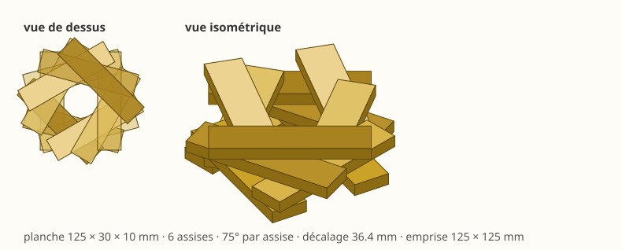

# Bâtir un mur vrillé — activité de programmation

IUT, université de Bordeaux · Dobot Magician et sa ventouse
À lire avec le [manuel](README.md) et la [procédure de mise en route](PROCEDURE_CONVOYEUR.md)

---

## La structure à réaliser



Des planches de **125 × 30 × 10 mm**, posées **deux par assise**, et
chaque assise **tournée de 75°** par rapport à la précédente. Six
assises, douze planches.

Vue de dessus, c'est une rosace. De côté, c'est un mur qui vrille.

> **Le robot prend toutes les planches au même endroit, dans la même
> orientation.** C'est donc lui qui les tourne, une par une, et c'est
> tout l'objet de l'activité : une cible n'est pas un point, c'est une
> **position *et* une orientation**.

---

## Ce que vous allez apprendre

Écrire les cibles **sans jamais déplacer le bras à la main pour lui
montrer où aller**. Toutes seront des **matrices homogènes 4×4**,
construites à partir de cotes mesurées au réglet.

> **Pourquoi ne pas apprendre les points à la main ?** Parce qu'un point
> appris ne dit pas *pourquoi* il est là. Déplacez le magasin de deux
> centimètres et il faut tout recommencer. Une cible écrite comme « le
> chantier, puis la planche dans le chantier » demande, elle, de
> changer **un seul nombre**.

Critère de réussite : **déplacez le magasin, changez une matrice, et le
cycle fonctionne encore.**

---

## 1. Mettre le robot en route

```bash
cd cellule
python dobot.py mise-en-route
```

Attendez la ligne **`mise en route terminee : defauts effaces`**. C'est
elle, et non « prise d'origine terminée », qui dit que la machine est
prête.

**Avant de lancer** : dégagez la zone, amenez le bras à une posture
franche et **haute**, la base au milieu de sa course. Le bras parcourt
toute sa course pendant l'origine, et gardez la main près de
l'interrupteur.

> **Question 1.** Pourquoi faut-il refaire cette opération à chaque mise
> sous tension ? Que perd le contrôleur quand on l'éteint ?

---

## 2. Mesurer l'outil, et le déclarer en matrice

### 2.1 Mesurer

```bash
python mesurer_outil.py
```

Amenez la **pointe de la ventouse au contact du plan de travail**, à la
main, en **plusieurs endroits** de la table. Le script lit les angles,
calcule la hauteur de la bride et en déduit la longueur :

```
L = z_bride(q) − z_plan
```

> **Question 2.** Les mesures doivent donner la même longueur partout —
> une longueur d'outil ne dépend pas de l'endroit. Si elles s'écartent
> de plusieurs millimètres, qu'est-ce que cela révélerait ?

Le bras a été déplacé à la main : **refaites une prise d'origine** avant
la suite.

### 2.2 Déclarer

L'outil est une **transformation** : de l'axe de rotation du poignet
jusqu'à la pointe.

```python
L_OUTIL = ...        # votre mesure, en millimetres

OUTIL = np.array([[1,  0,  0,        0],
                  [0, -1,  0,        0],
                  [0,  0, -1, -L_OUTIL],
                  [0,  0,  0,        1]], dtype=float)

robot.definir_repere_outil(OUTIL)
```

Lisez-la **colonne par colonne** — c'est ainsi qu'une matrice homogène
se lit :

| Colonne | Ce qu'elle dit |
|---|---|
| 0 : `(1, 0, 0)` | l'axe **x** de l'outil, celui de la bride |
| 1 : `(0, −1, 0)` | son **y**, retourné |
| 2 : `(0, 0, −1)` | son **z**, vers le **bas** : la direction d'approche |
| 3 : `(0, 0, −L)` | la **pointe**, L millimètres sous la bride |

> **Question 3.** Pourquoi le z de l'outil descend-il, alors que celui de
> la table monte ? Que se passerait-il si on l'oubliait en écrivant un
> dégagement ?

### 2.3 Vérifier

Une mesure non vérifiée n'est pas une mesure. Faites descendre la
ventouse sur un plan de cote connue et comparez.

- écart **constant**, le même partout → erreur de longueur d'outil :
  corrigez `L_OUTIL` ;
- écart **qui change selon l'endroit** → ce n'est pas l'outil, c'est
  l'origine des axes : reprenez l'étape 1.

---

## 3. Déclarer les deux repères

Mesurez au réglet, **par rapport au centre de la base du robot**, où se
trouvent le **magasin** (les planches à prendre) et le **chantier** (le
centre du mur).

```python
MAGASIN = np.array([[1, 0, 0, ...],
                    [0, 1, 0, ...],
                    [0, 0, 1,   0],
                    [0, 0, 0,   1]], dtype=float)

CHANTIER = np.array([[1, 0, 0, ...],
                     [0, 1, 0, ...],
                     [0, 0, 1,   0],
                     [0, 0, 0,   1]], dtype=float)
```

Partie rotation = identité : les deux sont parallèles à la base. La
dernière colonne porte leur position.

> Remarquez le contraste avec `OUTIL` : le z d'un repère de table pointe
> vers le **haut**, celui d'un outil vers le **bas**. Ce ne sont pas les
> mêmes objets.

> **Question 4.** Que faudrait-il changer si le magasin était posé en
> biais, tourné d'un quart de tour ? Combien de nombres reprendre ?

**Vérification** — `repere_travail(x=..., y=...)` construit la même
chose à partir de coordonnées :

```python
assert np.allclose(MAGASIN, repere_travail(x=..., y=...))
```

Si l'assertion passe, votre matrice est juste. **Gardez la vôtre** :
c'est elle que l'activité demande.

---

## 4. La prise, et le `@`

La planche est couchée à plat dans le magasin ; la ventouse se pose sur
son **dessus**, donc à une épaisseur du plan.

```python
LONGUEUR, LARGEUR, EPAISSEUR = 125.0, 30.0, 10.0

DANS_LE_MAGASIN = np.array([[1,  0,  0,         0],
                            [0, -1,  0,         0],
                            [0,  0, -1, EPAISSEUR],
                            [0,  0,  0,         1]], dtype=float)

PRISE = MAGASIN @ DANS_LE_MAGASIN
```

**C'est le cœur de l'activité.** La cible n'est pas un triplet de
coordonnées : c'est *le magasin*, suivi de *la planche dans le magasin*.

> **Question 5.** Dans `MAGASIN @ DANS_LE_MAGASIN`, l'ordre compte-t-il ?
> Essayez l'autre sens, regardez où part la cible, expliquez.

Les **approches et retraits** se composent aussi, mais **dans le repère
de l'outil** :

```python
HAUT = hg.translation(0, 0, -80)     # 80 mm AU-DESSUS

robot.movj(PRISE @ HAUT)             # approche
robot.movl(PRISE)                    # descente
...
robot.movl(PRISE @ HAUT)             # retrait
```

Le `−80` surprend : on monte, et le nombre est négatif. C'est que le z
de l'outil pointe vers le bas. Vérifiez-le plutôt que de le croire :

```python
assert (PRISE @ HAUT)[2, 3] > PRISE[2, 3], "le degagement descend !"
```

> **Question 6.** `PRISE @ HAUT` et `HAUT @ PRISE` ne donnent pas la même
> chose. Laquelle déplace l'outil **dans son propre repère** ?

---

## 5. La dépose : position **et** orientation

C'est ici que tout se joue. Deux choses changent d'une planche à
l'autre.

### 5.1 La hauteur

L'assise *n* repose sur les *n* précédentes :

```
z = (n + 1) × EPAISSEUR
```

### 5.2 L'orientation

L'assise *n* est tournée de `n × 75°`. Pour un angle `a`, la matrice
s'écrit :

```python
c, s = np.cos(np.radians(a)), np.sin(np.radians(a))

dans_le_chantier = np.array([[c,  s,  0, ex],
                             [s, -c,  0, ey],
                             [0,  0, -1,  z],
                             [0,  0,  0,  1]], dtype=float)
```

| Colonne | Ce qu'elle dit |
|---|---|
| 0 : `(c, s, 0)` | l'axe x de l'outil — donc la **longueur** de la planche |
| 1 : `(s, −c, 0)` | son y, retourné |
| 2 : `(0, 0, −1)` | son z, vers le bas |

C'est `Rz(a) · Rx(180°)` écrit en clair. À `a = 0` on retrouve la
matrice de la prise.

> **Question 7.** Vérifiez que c'est bien une rotation : colonnes
> unitaires, orthogonales deux à deux, déterminant **+1**. Pourtant la
> colonne 1 vaut `(s, −c, 0)`, et non `(−s, c, 0)` comme dans `Rz(a)`
> seul. D'où vient ce changement de signe, et sur quelle colonne agit
> encore le même retournement ?

### 5.3 L'écart des deux planches

Les deux planches d'une assise sont écartées de `±DECALAGE`,
**perpendiculairement** à leur longueur — donc le long de `(−sin a,
cos a)`.

**Et ce décalage n'est pas libre : il se déduit de l'angle.**

Une planche de l'assise du dessus croise celles du dessous à une
distance du centre qui vaut `DECALAGE / tan(a/2)`. Pour qu'elle repose
franchement, ce croisement doit rester à au moins une demi-largeur du
bout :

```
DECALAGE / tan(a/2)  ≤  LONGUEUR/2 − LARGEUR/2
```

d'où, en prenant l'égalité — le profil le plus large qui tienne :

```python
DECALAGE = (LONGUEUR - LARGEUR) / 2 * np.tan(np.radians(ANGLE) / 2)
```

> **Question 8.** Que vaut `DECALAGE` pour un angle de **90°** ?
> Retrouvez-vous une figure connue ? Expliquez pourquoi le carré
> classique du kapla est le cas particulier de cette formule.

> **Question 9.** Les deux planches d'une même assise ne doivent pas se
> chevaucher : il leur faut au moins une demi-largeur chacune. Écrivez
> cette condition, et **déduisez-en l'angle minimal**. Un quart de tour
> de 30° est-il possible avec ces planches ?

---

## 6. Voir les planches bouger

Le simulateur peut dessiner les planches et les faire **suivre la
ventouse** : on voit la planche quitter le magasin, traverser, et se
poser sur le mur.

```python
robot.poser_piece(x=..., y=..., dims=(125, 30, 10), magasin=True)
```

`magasin=True` : une autre réapparaît dès que le robot emporte
celle-ci — comme vous qui reposez une planche à chaque cycle. Sans
cela, le magasin se vide au premier passage.

C'est du **décor** : aucune instruction, aucune trajectoire, rien n'est
changé au programme. Mais une prise qui vise à côté se voit alors
immédiatement, et c'est bien plus parlant qu'une ligne de contrôle.

> Rembobinez la lecture : les planches reviennent exactement où elles
> étaient. Rien n'est accumulé dans ce simulateur — tout est **fonction
> du temps**, y compris ce que le robot porte.

---

## 7. La boucle

```python
robot.repli()
for assise in range(ASSISES):
    for planche in (0, 1):
        cible = depose(assise, planche)
        # prise : approche, descente, aspiration, retrait
        # depose : le meme geste, a la hauteur et dans l'orientation voulues
robot.repli()
```

---

## 8. Valider hors ligne, puis descendre sur la machine

```bash
python votre_programme.py          # sans --reel : le simulateur
```

```python
print(robot.resume())
for a in robot.controler():
    print(" -", a)
```

Le modèle vous dit, **machine éteinte**, ce que la machine découvrirait
à vos dépens.

### Le poignet, et sa course

Vous verrez sans doute passer une réserve de ce genre :

```
[47 MOVJ] cible : J4 outil = -103.04 deg hors de [-90 ; 90]
```

Le poignet ne tourne que dans `[−90° ; +90°]`. Or **une planche est
symétrique** : la poser à 165° ou à −15° revient au même, elle occupe la
même place. On peut donc ajouter ou retirer des demi-tours librement.

Mais attention — et c'est le piège :

```
J4 = orientation − J1
```

Les orientations atteignables sont centrées sur **J1**, c'est-à-dire sur
la direction où pointe le bras, **et non sur zéro**. Ramener dans
`]−90 ; +90]` par réflexe enverrait 165° sur −15°, et le poignet à
−105° : hors course, pour exactement la même planche au même endroit.

> **Question 10.** Dans quel intervalle faut-il ramener les
> orientations ? Écrivez la fonction qui le fait.

> **Question 11.** Le mur peut être bâti dans n'importe quelle
> orientation de départ — le tourner en entier ne change pas sa forme.
> Montrez qu'un départ à **15°** laisse 15° de marge au poignet, là où
> un départ à 0° le met en butée. Combien d'assises peut-on empiler
> avant que la course du poignet ne suffise plus, et pourquoi ?

**Ne descendez sur le robot qu'une fois les réserves levées.** Un cycle
validé hors ligne reste une hypothèse ; un cycle qui proteste hors ligne
est une certitude.

```bash
python votre_programme.py --reel
```

---

## 9. Pour aller plus loin

- **Changez l'angle** : 90°, 60°, 45°. Le décalage suit tout seul si
  vous l'avez écrit en fonction de l'angle. Quelle forme obtenez-vous à
  90° ?
- **Déplacez le magasin**, mesurez sa nouvelle position, changez **une
  seule matrice**. Si vous avez dû toucher autre chose, vos cibles
  n'étaient pas vraiment exprimées dans le repère.
- **Posez le magasin en biais** et décrivez-le par la partie rotation de
  `MAGASIN`.

---

## Ce qu'il faut rendre

1. Le programme, commenté — chaque cote mesurée doit dire **d'où elle
   vient**.
2. Les réponses aux onze questions.
3. La sortie de `robot.controler()`, et votre explication de ce qui
   limite la hauteur du mur.
