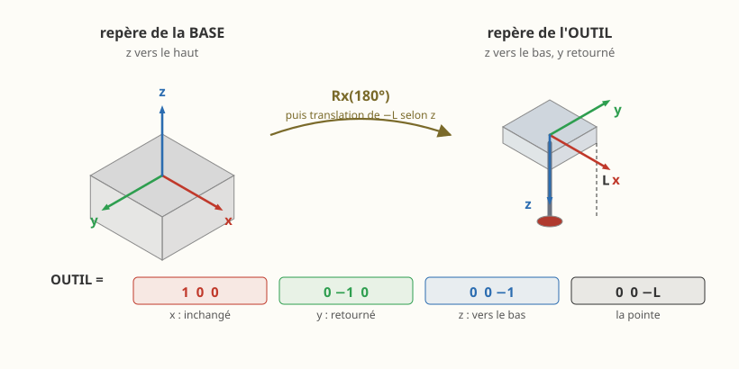

# Prendre et poser — activité de programmation

IUT, université de Bordeaux · Dobot Magician et sa ventouse
À lire avec le [manuel](README.md) et la [procédure de mise en route](PROCEDURE_CONVOYEUR.md)

---

## Le geste à réaliser

Le robot prend une planche dans un **magasin**, la pose sur un
**chantier**, et recommence. Quatre planches, rangées côte à côte.

C'est le geste le plus courant de la robotique industrielle, et il
tient en six instructions. Toute la difficulté est ailleurs : **dire au
robot où aller, sans jamais l'y amener à la main.**

> **Cette activité est la première des deux.** Elle installe l'outil,
> les repères, les cibles et le lissage. La suivante — [bâtir un mur
> vrillé](ACTIVITE_MUR_KAPLA.md) — s'en sert pour faire travailler les
> orientations.

---

## Ce que vous allez apprendre

1. **Mesurer l'outil** et le déclarer sous forme de matrice.
2. **Déclarer deux repères de travail** par rapport à la base du robot.
3. **Écrire les cibles** comme des produits de matrices, et les
   approches avec `@`.
4. **Lisser les raccords**, et mesurer ce que cela coûte et rapporte.

Toutes les cibles seront des **matrices homogènes 4×4**, construites à
partir de cotes mesurées au réglet.

> **Pourquoi ne pas apprendre les points à la main ?** Parce qu'un point
> appris ne dit pas *pourquoi* il est là. Déplacez le magasin de deux
> centimètres et il faut tout recommencer. Une cible écrite comme « le
> magasin, puis la planche dans le magasin » demande, elle, de changer
> **un seul nombre**.

Critère de réussite : **déplacez le magasin, changez une matrice, et le
cycle fonctionne encore.**

---

## 1. Mettre le robot en route

```bash
cd cellule
python dobot.py mise-en-route
```

Attendez la ligne **`mise en route terminee : defauts effaces`**. C'est
elle, et non « prise d'origine terminée », qui dit que la machine est
prête.

**Avant de lancer** : dégagez la zone, amenez le bras à une posture
franche et **haute**, la base au milieu de sa course. Le bras parcourt
toute sa course pendant l'origine ; gardez la main près de
l'interrupteur.

> **Question 1.** Pourquoi faut-il refaire cette opération à chaque mise
> sous tension ? Que perd le contrôleur quand on l'éteint ?

---

## 2. Mesurer l'outil, et le déclarer en matrice

### 2.1 Mesurer

```bash
python mesurer_outil.py
```

Amenez la **pointe de la ventouse au contact du plan de travail**, à la
main, en **plusieurs endroits** de la table. Le script lit les angles,
calcule la hauteur de la bride et en déduit la longueur :

```
L = z_bride(q) − z_plan
```

> **Question 2.** Les mesures doivent donner la même longueur partout —
> une longueur d'outil ne dépend pas de l'endroit. Si elles s'écartent
> de plusieurs millimètres, qu'est-ce que cela révélerait ?

Le bras a été déplacé à la main : **refaites une prise d'origine** avant
la suite.

### 2.2 Les deux repères, côte à côte



Regardez la figure avant d'écrire quoi que ce soit. Elle montre les deux
repères dont il est question :

| | Son `x` | Son `y` | Son `z` |
|---|---|---|---|
| **base** du robot | vers l'avant | à gauche de l'opérateur | vers le **haut** |
| **outil** (la ventouse) | le même | **retourné** | vers le **bas** |

Le `z` de l'outil pointe vers le bas parce que c'est sa **direction
d'approche** : l'outil avance vers la pièce, et la pièce est en
dessous. Un repère de *table*, lui, a son `z` vers le haut.

Passer de l'un à l'autre, c'est donc un **demi-tour autour de `x`** —
noté `Rx(180°)` — puis une translation de `L` jusqu'à la pointe.

### 2.3 Déclarer

```python
L_OUTIL = ...        # votre mesure, en millimetres

OUTIL = np.array([[1,  0,  0,        0],
                  [0, -1,  0,        0],
                  [0,  0, -1, -L_OUTIL],
                  [0,  0,  0,        1]], dtype=float)

robot.definir_repere_outil(OUTIL)
```

Lisez-la **colonne par colonne** — c'est ainsi qu'une matrice homogène
se lit, et c'est exactement ce que dit la figure :

| Colonne | Ce qu'elle dit |
|---|---|
| 0 : `(1, 0, 0)` | l'axe **x** de l'outil, celui de la bride : inchangé |
| 1 : `(0, −1, 0)` | son **y**, retourné par le demi-tour |
| 2 : `(0, 0, −1)` | son **z**, vers le **bas** : la direction d'approche |
| 3 : `(0, 0, −L)` | la **pointe**, L millimètres sous la bride |

> **Question 3.** Les trois premières colonnes forment la partie
> rotation. Vérifiez que c'est bien une rotation : colonnes unitaires,
> orthogonales deux à deux, déterminant **+1**. Que vaudrait le
> déterminant si l'on n'avait retourné **qu'un seul** axe, et
> qu'est-ce que cela décrirait alors ?

> **Question 4.** Pourquoi le `z` de l'outil descend-il, alors que celui
> de la table monte ? Que se passerait-il si on l'oubliait en écrivant
> un dégagement ?

### 2.4 Vérifier

Une mesure non vérifiée n'est pas une mesure. Faites descendre la
ventouse sur un plan de cote connue et comparez.

- écart **constant**, le même partout → erreur de longueur d'outil :
  corrigez `L_OUTIL` ;
- écart **qui change selon l'endroit** → ce n'est pas l'outil, c'est
  l'origine des axes : reprenez l'étape 1.

---

## 3. Déclarer les deux repères de travail

Mesurez au réglet, **par rapport au centre de la base du robot**, où se
trouvent le **magasin** (les planches à prendre) et le **chantier** (où
les poser).

```python
MAGASIN = np.array([[1, 0, 0, ...],
                    [0, 1, 0, ...],
                    [0, 0, 1,   0],
                    [0, 0, 0,   1]], dtype=float)

CHANTIER = np.array([[1, 0, 0, ...],
                     [0, 1, 0, ...],
                     [0, 0, 1,   0],
                     [0, 0, 0,   1]], dtype=float)
```

Partie rotation = identité : les deux sont parallèles à la base. La
dernière colonne porte leur position.

> **Question 5.** Que faudrait-il changer si le magasin était posé en
> biais, tourné d'un quart de tour ? Combien de nombres reprendre ?

**Vérification** — `repere_travail(x=..., y=...)` construit la même
chose à partir de coordonnées :

```python
assert np.allclose(MAGASIN, repere_travail(x=..., y=...))
```

Si l'assertion passe, votre matrice est juste. **Gardez la vôtre** :
c'est elle que l'activité demande.

---

## 4. Les cibles, et le `@`

### 4.1 La prise

La planche est couchée à plat dans le magasin ; la ventouse se pose sur
son **dessus**, donc à une épaisseur du plan.

```python
LONGUEUR, LARGEUR, EPAISSEUR = 125.0, 30.0, 10.0

DANS_LE_MAGASIN = np.array([[1,  0,  0,         0],
                            [0, -1,  0,         0],
                            [0,  0, -1, EPAISSEUR],
                            [0,  0,  0,         1]], dtype=float)

PRISE = MAGASIN @ DANS_LE_MAGASIN
```

**C'est le cœur de l'activité.** La cible n'est pas un triplet de
coordonnées : c'est *le magasin*, suivi de *la planche dans le
magasin*. Les trois premières colonnes de `DANS_LE_MAGASIN` sont celles
de `OUTIL` — c'est le même demi-tour, pour la même raison.

> **Question 6.** Dans `MAGASIN @ DANS_LE_MAGASIN`, l'ordre compte-t-il ?
> Essayez l'autre sens, regardez où part la cible, expliquez.

### 4.2 Les approches et les retraits

Elles se composent aussi, mais **dans le repère de l'outil** :

```python
HAUT = hg.translation(0, 0, -80)     # 80 mm AU-DESSUS

robot.movj(PRISE @ HAUT)             # approche
robot.movl(PRISE)                    # descente
robot.ventouse(True)
robot.attendre(0.3)
robot.movl(PRISE @ HAUT)             # retrait
```

Le `−80` surprend : on monte, et le nombre est négatif. C'est que le `z`
de l'outil pointe vers le bas. Vérifiez-le plutôt que de le croire :

```python
assert (PRISE @ HAUT)[2, 3] > PRISE[2, 3], "le degagement descend !"
```

> **Question 7.** `PRISE @ HAUT` et `HAUT @ PRISE` ne donnent pas la même
> chose. Laquelle déplace l'outil **dans son propre repère** ?

### 4.3 La dépose, et l'angle


Les planches se rangent côte à côte, toutes dans la même orientation
`a`. Pour un angle quelconque, la cible s'écrit :

```python
c, s = np.cos(np.radians(a)), np.sin(np.radians(a))

dans_le_chantier = np.array([[c,  s,  0, -s * d],
                             [s, -c,  0,  c * d],
                             [0,  0, -1, EPAISSEUR],
                             [0,  0,  0,      1]], dtype=float)

cible = CHANTIER @ dans_le_chantier
```

La figure dit d'où viennent `c` et `s`, et il n'y a rien d'autre à
retenir :

| Colonne | Ce qu'elle dit |
|---|---|
| 0 : `(c, s, 0)` | l'axe x de l'outil — donc la **longueur** de la planche. Ses composantes **sont** les projections `cos a` et `sin a` sur les axes du chantier |
| 1 : `(s, −c, 0)` | son y, **retourné** : c'est encore le demi-tour autour de x |
| 2 : `(0, 0, −1)` | son z, vers le bas |
| 3 | l'écart `d`, pris **perpendiculairement** à la planche, le long de `(−sin a, cos a)` |

C'est `Rz(a) · Rx(180°)` écrit en clair. À `a = 0` on retrouve la
matrice de la prise.

> **Question 8.** Dans `Rz(a)` seul, la deuxième colonne vaut
> `(−sin a, cos a)`. Ici elle vaut `(sin a, −cos a)`. D'où vient ce
> changement de signe, et sur quelle **autre** colonne agit le même
> retournement ? (La partie droite de la figure est l'indice.)

> **Question 9.** Pourquoi l'écart entre deux planches se prend-il le
> long de `(−sin a, cos a)` et non le long de `(cos a, sin a)` ? Faites
> le dessin pour `a = 90°`, puis vérifiez sur les cotes imprimées par
> votre programme.

### 4.4 Une orientation n'est pas toujours atteignable

Le poignet ne tourne que dans `[−90° ; +90°]`, et surtout :

```
J4 = orientation − J1
```

Les orientations atteignables sont donc centrées sur **la direction où
pointe le bras**, et non sur zéro. Si le chantier est droit devant le
robot (cap 90°), une rangée à `a = 0` demande au poignet exactement
`−90°` : la butée.

Lancez votre programme avec `a = 0` et regardez `robot.controler()`
protester, puis avec `a = 90` et voyez la réserve disparaître.

> **Question 10.** Expliquez, avec la relation ci-dessus, pourquoi
> `a = 90°` ne coûte rien au poignet alors que `a = 0` le met en butée.
> Une planche étant **symétrique**, poser à `a` ou à `a + 180°` revient
> au même : cela vous sauve-t-il ici ? Pourquoi ?

---

## 5. Le lissage

Sans lissage, le robot **s'arrête à chaque point de passage** — y
compris au-dessus du magasin, où il n'a rien à faire que passer.

```python
robot.movj(PRISE @ HAUT, lissage=70)      # pourcentage, de 0 a 100
```

`lissage` porte sur le raccord **avec l'instruction suivante**. Les deux
segments se **recouvrent** pendant une durée, sur laquelle la consigne
est le mélange pondéré des deux. À 100 %, le recouvrement vaut 49 % du
plus court des deux segments.

### 5.1 Ce que cela rapporte

```python
print(robot.resume())
```

La première ligne affiche les secondes gagnées. Relevez-les :

| `lissage` | durée du cycle |
|---|---|
| 0 % | … |
| 40 % | … |
| 70 % | … |
| 100 % | … |

### 5.2 Ce que cela coûte

**Un point lissé n'est plus atteint.** C'est le prix, et il se mesure :

```python
ech = robot.programme.construire(robot.robot, robot.q_depart).echantillonner(0.005)
P = np.asarray(ech["P"])
print(np.min(np.linalg.norm(P - (PRISE @ HAUT)[:3, 3], axis=1)), "mm")
```

> **Question 11.** Relevez cet écart pour les quatre valeurs de lissage.
> Faites la même mesure sur le **point de prise**. Que trouvez-vous, et
> pourquoi ?

### 5.3 La règle

**On ne lisse jamais un point où l'outil agit.** La ventouse qui aspire
à côté de la planche n'emporte rien. Dans le cycle ci-dessus, les
dégagements sont lissés et les deux points de contact restent à zéro.

Le modèle vous protège à moitié : il refuse de lisser autour d'une
`attendre()`, parce qu'une temporisation demandée doit être tenue. Mais
il **accepte** de lisser un point où vous commandez la ventouse — c'est
à vous de ne pas le faire.

> **Question 12.** Lissez volontairement le point de prise, lancez la
> lecture avec la planche affichée, et décrivez ce que vous voyez.

### 5.4 Sur la machine réelle

Ce contrôleur-ci **n'a pas de lissage en PTP**. À l'envoi, le pont
l'écrit noir sur blanc :

```
NOTE : le lissage n'existe pas en PTP sur le controleur ;
       le robot reel marquera un arret a chaque point.
```

Le simulateur vous montre donc ce que vous **gagneriez** avec un
contrôleur qui a des zones (ABB `zonedata`) ou du CNT (Fanuc). C'est
une mesure utile : elle chiffre ce que coûte un arrêt inutile.

> **Question 13.** Sur votre relevé du 5.1, quelle fraction du temps de
> cycle est perdue en arrêts ? Sur une journée de production à
> 3 000 cycles, cela fait combien ?

---

## 6. Voir la planche bouger

Le simulateur peut dessiner la planche et la faire **suivre la
ventouse** :

```python
robot.poser_piece(x=..., y=..., dims=(125, 30, 10), magasin=True)
```

`magasin=True` : une autre réapparaît dès que le robot emporte celle-ci
— comme vous qui reposez une planche à chaque cycle. Sans cela, le
magasin se vide au premier passage.

C'est du **décor** : aucune instruction, aucune trajectoire, rien n'est
changé au programme. Mais une prise qui vise à côté se voit alors
immédiatement.

> Si la fenêtre se couvre d'arcs bleus et de points jaunes, le menu
> **Affichage ▸ Vue épurée** (Ctrl+Shift+V) ne laisse que la cellule.

---

## 7. Valider hors ligne, puis descendre sur la machine

```bash
python votre_programme.py          # sans --reel : le simulateur
```

```python
print(robot.resume())
for a in robot.controler():
    print(" -", a)
```

Le modèle vous dit, **machine éteinte**, ce que la machine découvrirait
à vos dépens.

**Ne descendez sur le robot qu'une fois les réserves levées.** Un cycle
validé hors ligne reste une hypothèse ; un cycle qui proteste hors ligne
est une certitude.

```bash
python votre_programme.py --reel
```

---

## 8. Pour aller plus loin

- **Déplacez le magasin**, mesurez sa nouvelle position, changez **une
  seule matrice**. Si vous avez dû toucher autre chose, vos cibles
  n'étaient pas vraiment exprimées dans le repère.
- **Posez le magasin en biais** et décrivez-le par la partie rotation de
  `MAGASIN`.
- **Changez l'orientation de la rangée** et retrouvez, par le calcul,
  l'intervalle d'angles que le poignet accepte.

---

## Ce qu'il faut rendre

1. Le programme, commenté — chaque cote mesurée doit dire **d'où elle
   vient** et **par rapport à quoi**.
2. Les réponses aux treize questions.
3. Le tableau du 5.1 et celui de la question 11, avec votre conclusion
   sur ce que le lissage achète et ce qu'il coûte.
