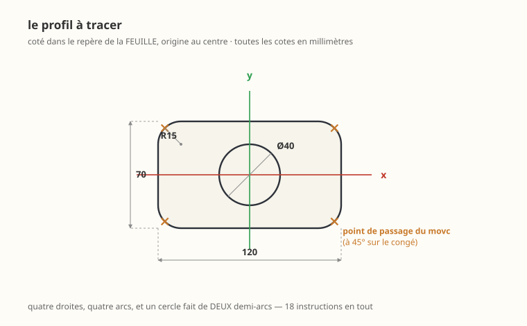
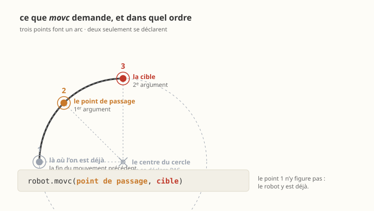

# Tracer un profil au stylo — activité de programmation

IUT, université de Bordeaux · Dobot Magician et son porte-stylo
À lire avec le [manuel](README.md) et la [procédure de mise en route](PROCEDURE_CONVOYEUR.md)

---

## Le profil à réaliser



Une feuille posée devant le robot, un stylo monté sur la bride, et un
**profil fermé** à tracer : quatre droites, quatre congés, et un
perçage au milieu.

Le geste change de nature. Jusqu'ici le robot allait d'un point à un
autre et ce qui se passait entre les deux était sans importance. **Ici
c'est le chemin lui-même qui est le résultat** — ce qui reste sur le
papier, c'est la trajectoire.

> **Deux instructions nouvelles**, et une seule vraiment : `movl` que
> vous connaissez trace une droite, `movc` trace un **arc de cercle**.
> Tout le reste — l'outil, le repère de travail, les cibles en 4×4 —
> vous l'avez déjà fait.

---

## Ce que vous allez apprendre

1. **Monter et régler un outil** dont la longueur décide de la qualité
   du résultat.
2. **Déclarer le repère de la feuille**, et y exprimer tout le dessin.
3. **Tracer une droite** avec `movl`, **un arc** avec `movc`, et
   comprendre ce que `movc` réclame de plus.
4. **Enchaîner** droites et arcs sans lever le stylo.
5. **Le lissage**, et ce qu'il fait au tracé — cette fois cela se voit
   sur le papier.

> **La règle d'écriture, comme dans les activités précédentes.** Une
> cible, un repère, une transformation se déclarent sous forme de
> **matrice 4×4 écrite en clair**, dernière ligne `0 0 0 1` comprise.

---

## 1. Mettre le robot en route

```bash
cd cellule
python dobot.py mise-en-route
```

Attendez la ligne **`mise en route terminee : defauts effaces`**.
Dégagez la zone, bras haut, base au milieu de sa course, main près de
l'interrupteur.

**Montez le porte-stylo** sur la bride, le stylo serré à fleur, et
posez la feuille devant le robot. Un morceau de ruban adhésif à chaque
coin : une feuille qui glisse sous le stylo ruine le tracé et ne
prévient pas.

---

## 2. Mesurer le stylo, et le déclarer

### 2.1 Mesurer

La longueur va de l'**axe de rotation du poignet** à la **pointe du
stylo**. Elle dépend de la profondeur à laquelle vous l'avez serré :
celle du voisin ne vaut pas pour vous.

```bash
python mesurer_outil.py
```

Amenez la pointe au contact du plan de travail, à la main, en
**plusieurs endroits**. Le bras a été déplacé à la main : **refaites
une prise d'origine** avant la suite.

### 2.2 Déclarer


```python
L_OUTIL = ...        # votre mesure, en millimetres

OUTIL = np.array([[1,  0,  0,        0],
                  [0, -1,  0,        0],
                  [0,  0, -1, -L_OUTIL],
                  [0,  0,  0,        1]], dtype=float)

robot = Pilote(nom="profil", outil="stylo",
               vitesse=60, acceleration=200, vitesse_articulaire=50)
robot.definir_repere_outil(OUTIL)
```

C'est la même matrice qu'avec la ventouse : le `z` de l'outil descend,
parce que c'est sa direction d'approche — ici, celle qui **appuie sur
le papier**.

> **Question 1.** Le porte-stylo n'a aucun actionneur : on ne le
> commande pas, il n'y a pas de `robot.ventouse(True)` qui tienne.
> Comment « lève-t-on » le stylo, alors ? Écrivez la cible
> correspondante.

### 2.3 Vérifier, et c'est ici que tout se joue

Une erreur de longueur d'outil de deux millimètres ne se voyait pas
avec la ventouse — elle aspirait quand même. **Avec un stylo, elle se
voit immédiatement** :

| Ce que vous voyez | Ce que cela veut dire |
|---|---|
| le stylo n'écrit pas, ou par intermittence | `L_OUTIL` trop **court** : la pointe reste en l'air |
| le papier se déchire, le bras force, le trait est gras | `L_OUTIL` trop **long** : le stylo laboure |
| un trait net et régulier | c'est bon |

Faites descendre le stylo au centre de la feuille, à `h = 0`, et
réglez `L_OUTIL` jusqu'à obtenir un trait net. **Un demi-millimètre
compte.**

> **Question 2.** L'écart est-il le même partout sur la feuille ? S'il
> change d'un bord à l'autre, ce n'est pas la longueur de l'outil qui
> est en cause — qu'est-ce que c'est, et comment le corrigeriez-vous ?

---

## 3. Les points du dessin, écrits en matrices

La feuille a son repère — vous savez le déclarer depuis la structure
de kapla. Deux lignes suffisent ici :

```python
FEUILLE = np.array([[1, 0, 0, ...],     # du centre de la base au centre
                    [0, 1, 0, ...],     # de la feuille
                    [0, 0, 1, ...],     # l'altitude du papier, support
                    [0, 0, 0,   1]], dtype=float)   # et epaisseur comprises
```

> **Mesurez l'altitude du papier**, support compris : c'est le `z` de
> ce repère, et c'est lui qui décide si le stylo touche.

**Un point du dessin est une matrice 4×4**, comme toutes les cibles
depuis le début. Celle-ci est remarquable : **sa partie rotation ne
change jamais**. Le stylo ne tourne pas, il se promène.

```python
#  le point (x, y) du dessin, a h millimetres AU-DESSUS du papier
dans_la_feuille = np.array([[1,  0,  0, x],
                            [0, -1,  0, y],
                            [0,  0, -1, h],
                            [0,  0,  0, 1]], dtype=float)

cible = FEUILLE @ dans_la_feuille
```

C'est l'exact contraire de la structure de kapla, où la position
restait et où l'orientation travaillait. Ici l'orientation est figée et
c'est la **dernière colonne** qui porte tout le dessin.

Le profil en demande une quinzaine : écrivez-la **une fois**, dans une
fonction, et donnez-lui les trois cotes.

```python
def point(x, y, h=0.0):
    dans_la_feuille = np.array([[1,  0,  0, x],
                                [0, -1,  0, y],
                                [0,  0, -1, h],
                                [0,  0,  0, 1]], dtype=float)
    return FEUILLE @ dans_la_feuille
```

> **Question 3.** `h` est compté **vers le haut** depuis le papier,
> mais il s'écrit tel quel dans une matrice dont le `z` descend.
> Pourquoi n'y a-t-il pas de signe `−` ? Faites le calcul sur un point
> à `h = 12` et vérifiez la cote obtenue dans la base.

> **Question 4.** Vous déplacez la feuille de 2 cm. Combien de nombres
> changez-vous ? Et si vous la posiez **en biais** — quelle partie de
> quelle matrice ?

---

## 4. Les droites, et les arcs

### 4.1 Une droite

```python
robot.movl(point(x, y))
```

Rien de neuf : le TCP va en ligne droite, et le stylo laisse un trait.

### 4.2 Un arc : ce que `movc` réclame de plus



```python
robot.movc(point(xv, yv), point(x, y))
#          ^^^^^^^^^^^^^  le POINT DE PASSAGE
```

**`movc` trace l'arc qui passe par trois points** : là où l'on est, le
point de passage, et la cible. Trois points définissent un cercle et un
seul — c'est toute l'affaire.

Et **deux seulement se déclarent**, dans cet ordre :

| | Le point | Comment il arrive dans l'appel |
|---|---|---|
| ① | là où l'on est déjà | il ne se déclare pas : c'est la fin du mouvement précédent |
| ② | le point de passage | **premier** argument |
| ③ | la cible | **second** argument |

> **Le point de passage n'est pas le centre du cercle.** C'est l'erreur
> à faire une fois : c'est un point **du tracé**, par lequel le stylo
> passe réellement. Le centre, lui, n'entre nulle part dans l'appel —
> c'est pourquoi la figure le barre.

Pour un **quart de cercle**, prenez-le à **45°** sur le congé. C'est le
seul endroit qui se calcule sans effort, et c'est aussi le plus éloigné
de la corde — donc le plus sûr numériquement.

```python
BIAIS = RAYON * np.sqrt(2) / 2      # la projection du point a 45 deg
```

Les quatre croix de la figure sont ces points-là.

> **Question 5.** Que se passe-t-il si les trois points sont
> **alignés** ? Essayez : mettez le point de passage au milieu de la
> corde, lancez, et lisez ce que dit `robot.controler()`. Pourquoi le
> modèle ne peut-il pas deviner ce que vous vouliez ?

> **Question 6.** Un **cercle complet** ne se trace pas avec un seul
> `movc`. Expliquez pourquoi, en raisonnant sur les trois points. Puis
> écrivez le perçage de la figure — il en faut **deux**.

### 4.3 Lever et poser

Le porte-stylo n'a pas d'actionneur : lever le stylo, c'est **aller à
la même cible, plus haut**.

```python
LEVEE = 12.0                         # mm au-dessus du papier

robot.movj(point(x, y, LEVEE), lissage=60)     # on arrive au-dessus
robot.movl(point(x, y), vitesse=30)            # on pose
...                                            # on trace
robot.movl(point(x, y, LEVEE), vitesse=30)     # on leve
```

**Posez et levez à vitesse réduite.** Une descente rapide sur le papier
fait un point d'encre, et une remontée rapide une bavure.

> **Question 7.** Pourquoi le mouvement d'approche est-il un `movj` et
> les deux autres des `movl` ? Que risqueriez-vous à faire la descente
> en `movj` ?

---

## 5. Le profil

Le dessin se compose de constantes, pas de nombres recopiés :

```python
LARGEUR, HAUTEUR, RAYON = 120.0, 70.0, 15.0

DX, DY = LARGEUR / 2, HAUTEUR / 2      # demi-cotes
CX, CY = DX - RAYON, DY - RAYON        # centres des conges
```

**Un seul trait fermé** : on descend une fois, on remonte une fois, et
entre les deux droites et arcs s'enchaînent sans lever le stylo. C'est
ce qui distingue un *profil* d'une suite de traits.

> **Question 8.** Changez `RAYON` de 15 à 25. Combien de lignes de
> votre programme avez-vous dû reprendre ? Si la réponse n'est pas
> « aucune », vos cotes ne sont pas des paramètres.
>
> Puis montez à **35**, et calculez `CY` : que devient le côté droit ?
> Quelle figure obtient-on ? Au-delà de 35, le dessin n'a plus de sens
> — et pourtant `controler()` ne dit rien. Pourquoi ? **Ce qu'il
> vérifie et ce qu'il ne vérifie pas** vaut la peine d'être écrit.

> **Question 9.** Le profil est tracé dans le sens trigonométrique.
> Tracez-le dans l'autre sens : qu'est-ce qui change dans votre code ?
> Et sur le papier ?

---

## 6. Le lissage, et ce qu'il fait au tracé

Vous avez lissé des raccords au pick and place, et vous avez mesuré ce
que cela rapportait en secondes. **Ici vous allez le voir sur le
papier.**

```python
robot.movl(point(x, y), lissage=70)      # pourcentage, de 0 a 100
```

### 6.1 Deux essais, et ils ne disent pas la même chose

**Essai A — votre profil.** Lissez tous les raccords, de 0 à 100 %,
et mesurez l'écart au profil théorique.

**Essai B — le même rectangle, mais à angles vifs.** Retirez les
congés : quatre `movl`, quatre coins à 90°. Lissez de la même façon.

> **Question 10.** Relevez pour les deux essais la **durée** et
> l'**écart maximal au tracé voulu** :
>
> | `lissage` | A — à congés | B — à angles vifs |
> |---|---|---|
> | 0 % | … | … |
> | 50 % | … | … |
> | 100 % | … | … |
>
> Les deux colonnes ne se ressemblent pas du tout. Pourquoi ?

### 6.2 Ce que le lissage coupe, et ce qu'il ne coupe pas

Le lissage arrondit un **changement de direction**. Or dans votre
profil, une droite et son congé se raccordent **tangentiellement** :
la direction ne change pas d'un coup, elle tourne déjà. Il n'y a donc
presque rien à couper — et le lissage rend ses secondes presque
gratuitement.

Un **angle vif**, lui, est un changement brutal de direction. Le
lissage le mange, et cela se voit à l'œil nu sur le papier.

> **Question 11.** À quel pourcentage l'écart dépasse-t-il le dixième
> de millimètre dans chaque essai ? Et le demi-millimètre ?
> **Jusqu'où peut-on lisser sans que le dessin change**, dans un cas
> et dans l'autre ?

> **Question 12.** Un bureau d'études vous donne un profil où toutes
> les reprises sont tangentes. Que pouvez-vous vous permettre que vous
> ne pourriez pas sur un profil à angles vifs ? Formulez-le comme une
> règle d'atelier, en une phrase.

### 6.3 Les deux points qu'on ne lisse jamais

Ceux où le stylo **se pose** et où il **se lève**. Un point de contact
lissé n'est pas atteint : le stylo commence son trait en l'air, ou le
finit en appuyant. Laissez-les à `lissage=0` — c'est-à-dire ne mettez
rien.

> **Question 13.** Lissez volontairement la descente sur le papier à
> 100 %, et regardez le début du trait dans la vue 3D. Puis dites
> pourquoi on retrouve ici, mot pour mot, la règle du pick and place :
> *on ne lisse jamais un point où l'outil agit.*

---

## 7. Valider hors ligne, puis transférer sur la machine

```bash
python votre_programme.py          # sans --reel : le simulateur
```

```python
print(robot.resume())
for a in robot.controler():
    print(" -", a)
```

La vue 3D montre le chemin du stylo : vous voyez le profil **avant**
d'user du papier. Le menu **Affichage ▸ Vue épurée** (Ctrl+Shift+V) ne
laisse que la cellule et le tracé.

> **Question 14.** Éloignez la feuille de 5 cm et relancez
> `controler()`. Comptez les réserves, et regardez **quelle
> instruction** la première met en défaut, puis **quelle articulation**
> proteste. Pourquoi est-ce ce bord-là du profil et pas un autre ?
> Qu'est-ce que cela vous apprend sur l'endroit où poser la feuille ?

**Ne transférez sur le robot qu'une fois la simulation validée.**

```bash
python votre_programme.py --reel
```

---

## 8. Pour aller plus loin

- **Un congé qui n'est pas un quart de cercle** : reprenez un coin avec
  un arc de 30°. Où passe le point de passage ?
- **Deux perçages** au lieu d'un, symétriques par rapport au centre.
- **Le même profil, tourné de 30°** sur la feuille. Une seule matrice
  doit changer — laquelle ?
- Comparez votre tracé à `examples/trace_svg.py`, qui suit les chemins
  d'un fichier SVG. Que fait-il que vous ne faites pas, et
  inversement ?

---

## Ce qu'il faut rendre

1. Le programme, commenté — chaque cote doit dire **d'où elle vient**.
2. Les réponses aux quatorze questions.
3. **La feuille tracée**, avec au dos la valeur de `L_OUTIL` que vous
   avez retenue et la façon dont vous l'avez réglée.
4. Votre relevé de la question 8 : le nombre de lignes reprises pour
   passer de R15 à R25.
5. **Le tableau de la question 10**, les deux essais côte à côte, et
   votre règle d'atelier de la question 12.
