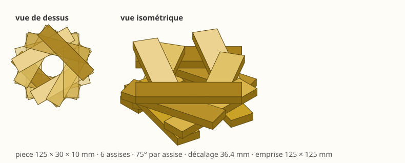
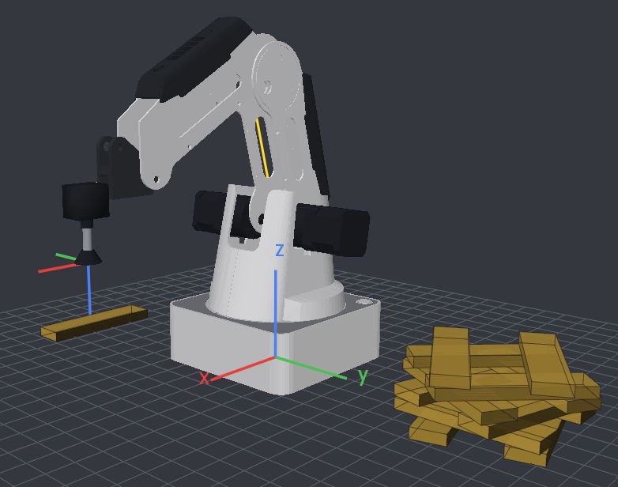
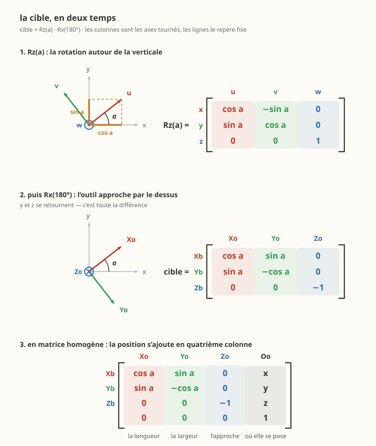

# Bâtir une structure vrillée — activité de programmation

IUT, université de Bordeaux · Dobot Magician et sa ventouse
À lire avec le [manuel](README.md) et la [procédure de mise en route](PROCEDURE_CONVOYEUR.md)

---

## La structure à réaliser



Des pièces de **125 × 30 × 10 mm**, posées **deux par assise**, et
chaque assise **tournée de 75°** par rapport à la précédente. Six
assises, douze pièces.

Vue de dessus, c'est une rosace. De côté, c'est une structure qui
vrille.



La même structure dans le simulateur, à la fin du cycle. À **droite**, les
six assises posées. À **gauche**, le magasin, où la ventouse revient
chercher chaque pièce — toujours au même endroit, toujours dans la
même orientation.

> La structure n'est pas au milieu de l'image par hasard : elle est
> **droit devant le robot**, et le magasin **sur le côté**. Cette disposition
> n'est pas un détail d'esthétique — la section 6 montrera qu'elle
> décide de ce que le poignet peut faire.

> **Le robot prend toutes les pièces au même endroit, dans la même
> orientation.** C'est donc lui qui les tourne, une par une, et c'est
> tout l'objet de l'activité : une cible n'est pas un point, c'est une
> **position *et* une orientation**.

---

## Ce qui est acquis, et ce qui ne l'est pas

Cette activité **continue** [Prendre et
poser](ACTIVITE_PICK_AND_PLACE.md). On y reprend tel quel :

| Acquis | Ce qu'on en garde |
|---|---|
| mise en route | `python dobot.py mise-en-route`, puis la ligne `defauts effaces` |
| matrice de l'outil | `OUTIL`, mesurée puis vérifiée par une descente |
| la cible comme situation | une matrice 4×4 : position **et** orientation |
| les dégagements | `CIBLE @ HAUT`, la 4×4 d'une translation de −80 en z |
| le lissage | lissé sur les dégagements, jamais sur un point de contact |

```python
L_OUTIL = ...                                     # votre mesure
OUTIL = np.array([[1,  0,  0,        0],
                  [0, -1,  0,        0],
                  [0,  0, -1, -L_OUTIL],
                  [0,  0,  0,        1]], dtype=float)
robot.definir_repere_outil(OUTIL)

HAUT = np.array([[1, 0, 0,   0],
                 [0, 1, 0,   0],
                 [0, 0, 1, -80],     # 80 mm AU-DESSUS
                 [0, 0, 0,   1]], dtype=float)
```

**Ce qui change, et c'est le cœur de la séance :** la dernière fois,
vos deux cibles étaient écrites directement par rapport à la base du
robot. Ici il y en a **douze**, à six hauteurs et six orientations.
Écrites de la même façon, elles deviendraient ingérables — vous l'avez
pressenti à la question 15 du sujet précédent.

On va donc **déclarer des repères de programmation**.

---

## 1. Les repères de programmation

### 1.1 Ce qu'on y gagne, avant de les écrire

Un repère de programmation est un **point de la cellule qu'on nomme**,
et par rapport auquel on exprime ensuite les cibles. Ici il en faut
deux : le **magasin**, où les pièces sont présentées, et la
**structure**, le centre de ce qu'on bâtit.

L'intérêt tient en une phrase : **chaque nombre ne dit plus qu'une
seule chose.**

| Ce qui change dans l'atelier | Ce qu'on reprend dans le programme |
|---|---|
| le magasin est déplacé | la dernière colonne de `MAGASIN`, et rien d'autre |
| les pièces font 8 mm | la constante `EPAISSEUR`, et rien d'autre |
| la structure est bâtie ailleurs | la dernière colonne de `STRUCTURE` |
| la structure vrille de 60° au lieu de 75° | la constante `ANGLE` |

Sans repères, chacune de ces quatre lignes toucherait les douze cibles
à la fois — et une cote y mélangerait toujours deux faits.

### 1.2 Les écrire

Mesurez au réglet, **par rapport au centre de la base du robot**, où se
trouvent le magasin et le centre de la structure.

```python
MAGASIN = np.array([[1, 0, 0, ...],
                    [0, 1, 0, ...],
                    [0, 0, 1,   0],
                    [0, 0, 0,   1]], dtype=float)

STRUCTURE = np.array([[1, 0, 0, ...],
                      [0, 1, 0, ...],
                      [0, 0, 1,   0],
                      [0, 0, 0,   1]], dtype=float)
```

Partie rotation = **identité** : les deux sont parallèles à la base. La
dernière colonne porte leur position.

> **Un repère de table a son `z` vers le HAUT.** C'est le contraste avec
> `OUTIL`, dont le `z` descend : l'un décrit un plan qui porte, l'autre
> un outil qui approche. Ce ne sont pas les mêmes objets.

> **Question 1.** Que faudrait-il changer si le magasin était posé en
> biais, tourné d'un quart de tour ? Combien de nombres reprendre, et
> dans quelle partie de la matrice ?

**Vérification** — `repere_travail(x=..., y=...)` construit la même
chose à partir de coordonnées :

```python
assert np.allclose(MAGASIN, repere_travail(x=..., y=...))
```

Si l'assertion passe, votre matrice est juste. **Gardez la vôtre** :
c'est elle que l'activité demande.

### 1.3 La prise, enfin séparée en deux faits

```python
LONGUEUR, LARGEUR, EPAISSEUR = 125.0, 30.0, 10.0

DANS_LE_MAGASIN = np.array([[1,  0,  0,         0],
                            [0, -1,  0,         0],
                            [0,  0, -1, EPAISSEUR],
                            [0,  0,  0,         1]], dtype=float)

PRISE = MAGASIN @ DANS_LE_MAGASIN
```

Comparez avec ce que vous aviez écrit la dernière fois. La cible est la
même ; ce qui a changé, c'est qu'elle **se lit** : *le magasin*, puis
*la pièce dans le magasin*. La cote `EPAISSEUR` ne parle plus que de
la pièce, et les cotes du magasin ne parlent plus que du magasin.

> **Question 2.** Dans `MAGASIN @ DANS_LE_MAGASIN`, l'ordre compte-t-il ?
> Essayez l'autre sens, regardez où part la cible, expliquez.

> **Question 3.** Reprenez votre programme de la séance précédente et
> celui-ci. Glissez une cale de 5 mm sous le magasin : montrez que dans
> l'un vous devez réfléchir à ce que vous corrigez, et dans l'autre non.

---

## 2. La dépose : position **et** orientation

### 2.1 La hauteur

L'assise *n* repose sur les *n* précédentes :

```
z = (n + 1) × EPAISSEUR
```

C'est le **décalage d'empilement**, et il doit être un paramètre : des
pièces de 8 mm ne doivent demander qu'une ligne à changer.

### 2.2 L'orientation



L'assise *n* est tournée de `n × 75°`. La cible s'écrit en 4×4, comme
toujours :

```python
c, s = np.cos(np.radians(a)), np.sin(np.radians(a))

dans_la_structure = np.array([[c,  s,  0, ex],
                              [s, -c,  0, ey],
                              [0,  0, -1,  z],
                              [0,  0,  0,  1]], dtype=float)

cible = STRUCTURE @ dans_la_structure
```

**D'où viennent ces seize nombres ?** Du même produit qu'à l'activité
précédente — on va à sa place, on tourne de `a`, on retourne l'outil :

```python
assert np.allclose(dans_la_structure,
                   hg.translation(ex, ey, z)
                   @ hg.rot_z(np.radians(a))
                   @ hg.rot_x(np.pi))
```

> **Le produit de deux matrices homogènes** demande quelques précautions
> — l'ordre, les repères successifs, la lecture colonne par colonne. La
> [fiche sur les matrices homogènes](fiches/fiche_matrices.html) les
> reprend depuis le cours.

**Rappel de l'activité précédente, parce que c'est là que tout se
joue :** `Rx(180°)` est écrit **à droite**, donc il tourne dans le
repère **intermédiaire** `(u, v, w)` que `Rz(a)` vient de produire —
autour de `u`, et non autour du `x` de la base. `u` est l'axe du
demi-tour et ne bouge pas ; `v` et `w` se retournent. D'où `(sin a,
−cos a, 0)` et `(0, 0, −1)`.

Et elle se lit colonne par colonne, comme toutes les autres :

| Colonne | Ce qu'elle dit |
|---|---|
| <code>0&nbsp;:&nbsp;(c,&nbsp;s,&nbsp;0)</code> | l'axe x de l'outil : la **longueur** de la pièce |
| <code>1&nbsp;:&nbsp;(s,&nbsp;−c,&nbsp;0)</code> | son y, **retourné** par le demi-tour autour de `u` |
| <code>2&nbsp;:&nbsp;(0,&nbsp;0,&nbsp;−1)</code> | son z, vers le bas : la direction d'approche |
| <code>3</code> | l'écart et la hauteur : où la pièce se pose |

Les composantes de la première colonne **sont** les projections `cos a`
et `sin a` sur les axes de la base — c'est tout ce que dit le premier
panneau de la figure.

Rien de neuf par rapport à l'activité précédente — **seul `a` change
désormais d'une assise à l'autre**, et c'est tout ce qui fait vriller
la structure.

> **Question 4.** Vérifiez une fois pour toutes que c'est une rotation :
> colonnes unitaires, orthogonales deux à deux, déterminant **+1**.
> Le déterminant vaut-il encore `+1` quand `a` change ? Pourquoi
> était-ce prévisible ?

---

## 3. L'écart des deux pièces d'une assise

Les deux pièces d'une assise sont écartées de `±DECALAGE`,
**perpendiculairement** à leur longueur — donc le long de
`(−sin a, cos a)`.

**Et ce décalage n'est pas libre : il se déduit de l'angle.**

Une pièce de l'assise du dessus croise celles du dessous à une
distance du centre qui vaut `DECALAGE / tan(a/2)`. Pour qu'elle repose
franchement, ce croisement doit rester à au moins une demi-largeur du
bout :

```
DECALAGE / tan(a/2)  ≤  LONGUEUR/2 − LARGEUR/2
```

d'où, en prenant l'égalité — le profil le plus large qui tienne :

```python
DECALAGE = (LONGUEUR - LARGEUR) / 2 * np.tan(np.radians(ANGLE) / 2)
```

> **Question 5.** Que vaut `DECALAGE` pour un angle de **90°** ?
> Retrouvez-vous une figure connue ? Expliquez pourquoi le carré
> classique du kapla est le cas particulier de cette formule.

> **Question 6.** Les deux pièces d'une même assise ne doivent pas se
> chevaucher : il leur faut au moins une demi-largeur chacune. Écrivez
> cette condition, et **déduisez-en l'angle minimal**. Un quart de tour
> de 30° est-il possible avec ces pièces ?

> **Question 7.** Pourquoi l'écart se prend-il le long de
> `(−sin a, cos a)` ? Que donnerait `(cos a, sin a)`, et à quoi
> ressemblerait la structure ?

---

## 4. La boucle

```python
robot.repli()
for assise in range(ASSISES):
    for pièce in (0, 1):
        cible = depose(assise, pièce)
        # prise  : approche, descente, aspiration, retrait
        # depose : le meme geste, a la hauteur et dans l'orientation voulues
robot.repli()
```

Une seule fonction `depose(assise, pièce)` doit produire les douze
cibles. Si vous avez écrit douze matrices, recommencez.

> **Question 8.** Votre `depose` prend deux entiers et rend une matrice.
> Quels sont **tous** les nombres mesurés dont elle dépend ? Faites-en
> la liste, et dites pour chacun ce qu'il faudrait reprendre s'il
> changeait. Combien en auriez-vous eu sans les repères ?

---

## 5. Voir les pièces bouger

```python
robot.poser_piece(x=..., y=..., dims=(125, 30, 10), magasin=True)
```

La fenêtre dessine la pièce et la fait **suivre la ventouse** : on la
voit quitter le magasin, traverser, et se poser sur la structure. Une prise
qui vise à côté se voit alors immédiatement.

`magasin=True` : une autre réapparaît dès que le robot emporte
celle-ci — comme l'opérateur qui repose une pièce à chaque cycle.
Sans cela, le magasin se vide au premier passage et les onze cycles
suivants brassent du vide.

> Rembobinez la lecture : les pièces reviennent exactement où elles
> étaient. Rien n'est accumulé dans ce simulateur — tout est **fonction
> du temps**, y compris ce que le robot porte.

> Douze cycles couvrent la vue d'arcs bleus et de points jaunes :
> **Affichage ▸ Vue épurée** (Ctrl+Shift+V) ne laisse que la cellule et
> la structure.

---

## 6. Valider hors ligne, puis transférer sur la machine

```bash
python votre_programme.py          # sans --reel : le simulateur
```

```python
print(robot.resume())
for a in robot.controler():
    print(" -", a)
```

### Le poignet, et sa course

C'est **ici** que la structure vrillée se distingue d'un pick and
place. Vous
verrez passer des réserves de ce genre :

```
[47 MOVJ] cible : J4 outil = -103.04 deg hors de [-90 ; 90]
```

Le poignet ne tourne que dans `[−90° ; +90°]`. Or **une pièce est
symétrique** : la poser à 165° ou à −15° revient au même, elle occupe la
même place. On peut donc ajouter ou retirer des demi-tours librement.

Mais attention — et c'est le piège :

```
J4 = orientation − J1
```

Les orientations atteignables sont centrées sur **J1**, c'est-à-dire sur
la direction où pointe le bras, **et non sur zéro**. Ramener dans
`]−90 ; +90]` par réflexe enverrait 165° sur −15°, et le poignet à
−105° : hors course, pour exactement la même pièce au même endroit.

> **Question 9.** Dans quel intervalle faut-il ramener les
> orientations ? Écrivez la fonction qui le fait.

> **Question 10.** La structure peut être bâtie dans n'importe quelle
> orientation de départ — le tourner en entier ne change pas sa forme.
> Montrez qu'un départ à **15°** laisse 15° de marge au poignet, là où
> un départ à 0° le met en butée. Combien d'assises peut-on empiler
> avant que la course du poignet ne suffise plus, et pourquoi ?

> **Question 11.** Le dégagement vaut 80 mm et non 90. Montez-le à 90,
> relancez `controler()`, et expliquez la réserve qui apparaît sur J2.
> Qu'est-ce que cela dit d'un dégagement « généreux » ?

**Ne transférez sur le robot qu'une fois la simulation validée.**

```bash
python votre_programme.py --reel
```

---

## 7. Pour aller plus loin

- **Changez l'angle** : 90°, 60°, 45°. Le décalage suit tout seul si
  vous l'avez écrit en fonction de l'angle. Quelle forme obtenez-vous à
  90° ?
- **Changez l'épaisseur** des pièces dans une seule constante, et
  vérifiez que la structure monte toujours juste.
- **Déplacez le magasin**, mesurez sa nouvelle position, changez **une
  seule matrice**. Si vous avez dû toucher autre chose, vos cibles
  n'étaient pas vraiment exprimées dans le repère.
- **Posez le magasin en biais** et décrivez-le par la partie rotation de
  `MAGASIN`. Le reste du programme ne doit pas bouger.

---

## Ce qu'il faut rendre

1. Le programme, commenté — chaque cote mesurée doit dire **d'où elle
   vient** et **par rapport à quoi**.
2. Les réponses aux onze questions.
3. La sortie de `robot.controler()`, et votre explication de ce qui
   limite la hauteur de la structure.
4. La comparaison demandée à la question 3 : le même changement
   d'atelier, traité sans repères puis avec.
